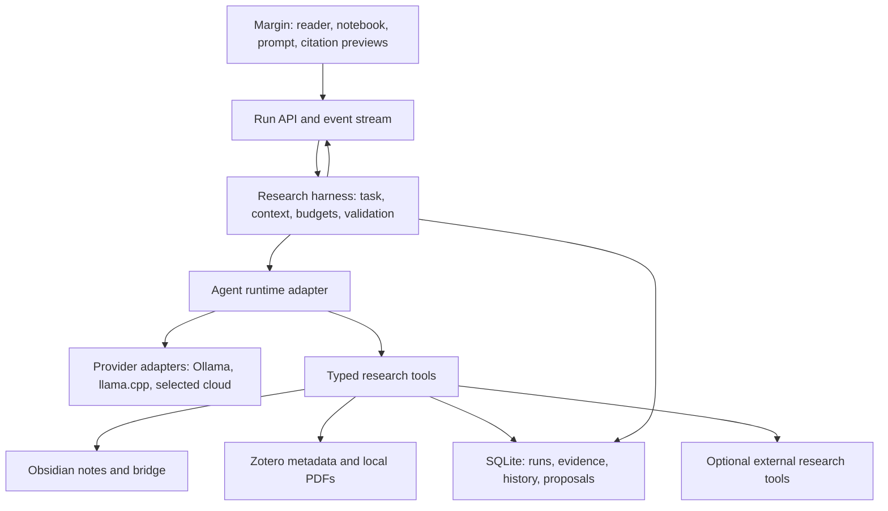

# Margin agent harness: implementation plan

Date: 2026-10-29. Status: proposed implementation, grounded in the current application and retrieved design discussions. This document changes no runtime behavior.

Build the harness in Margin's application server, between the reading interface and model providers. It should own evidence retrieval, tool execution, context budgets, durable session state, output validation, and navigation. Obsidian remains the canonical editor; Zotero remains the source library. The interface exposes this machinery through useful answers, named citations, source previews, and visible retrieval progress.

The first release must solve the reported failure end to end: identify references [11], [12], and [26] by reading the current paper's bibliography, while rendering every cited note by its actual name with an immediate route into Obsidian. A larger prompt alone cannot provide this behavior.

## 1. Requirements recovered from the actual failure

The saved user question was **“What are these citations 11,12,26”**. The answer reported insufficient excerpt context, mentioned two anonymous notes, and redirected the conversation toward connectivity contracts. The requested task was bibliographic identification.

The saved evidence for that answer identifies the anonymous notes:

| Old label | Actual note | Vault-relative path |
| --- | --- | --- |
| N2 | [Algebraic Connectivity (Spectral Gap)](obsidian://open?vault=valut&file=000_zettelkasten%2FAlgebraic%20Connectivity%20%28Spectral%20Gap%29.md) | `000_zettelkasten/Algebraic Connectivity (Spectral Gap).md` |
| N4 | [Spectral Properties of Graph Laplacian](obsidian://open?vault=valut&file=000_zettelkasten%2FSpectral%20Properties%20of%20Graph%20Laplacian.md) | `000_zettelkasten/Spectral Properties of Graph Laplacian.md` |

The active source was **Distributed Model Predictive Control with Connectivity-based Contracts**, PDF page 2; its literature note was `900_references/@geurtsDistributedModelPredictive2026.md`. These identities were read from the existing local artifact, and both note paths were checked against the currently configured vault. The links above open those notes in Obsidian. This inspection did not independently verify their mathematical claims or identify the bibliography entries.

The resulting product requirements are:

1. **Answer the requested task.** A reference-identification question should return reference entries, or a precise account of which entries could not be recovered and why.
2. **Resolve missing context automatically.** An absent bibliography in the initial excerpt should trigger retrieval from the available paper. Reading connected local evidence requires no additional user confirmation.
3. **Use descriptive, navigable citations.** A citation should show a note title and section, or a paper title and page, at its point of use. The user should not need to open an evidence drawer to decode N2.
4. **Preserve historical identity.** N2 in one answer may refer to a different note than N2 in the previous answer. Resolution must use that answer's saved evidence mapping.
5. **Distinguish knowing a note exists from knowing its contents.** Search hits are candidates; reading the relevant passage supplies evidence. A note's existence says nothing about the user's mastery.
6. **Preserve intellectual provenance.** Source text, user reasoning, AI edits, AI inferences, and accepted knowledge remain distinguishable.
7. **Make local tools useful across model backends.** Model selection and server changes should not change source identity, vault navigation, or write permissions.

These requirements extend [the existing design](design.md), especially its sections on provenance, Obsidian integration, autonomy, the knowledge index, and resumable research inquiries. The retrieved chats **Design Research Tutor Workflow**, **Local model recommendation**, and **Explain Pi Agent Harness** supply additional context. Earlier model-performance discussion motivates measurement; its throughput figures are historical observations, not capacity guarantees for this implementation.

## 2. What exists and where it fails

This baseline was inspected on 2026-10-29. Another chat is actively changing prompt-level model selection, so its provider configuration should be integrated through a stable boundary rather than overwritten.

| Component | Existing behavior | Required change |
| --- | --- | --- |
| `server/tutor.mjs` | Creates S1 from one page, capped at 9,000 characters; attaches note excerpts; instructs the model to cite opaque IDs; makes one model call. | Keep interaction policies; delegate execution to the harness and an evidence registry. |
| `server/retrieval.mjs` | Combines lexical, semantic, and explicit-link candidates; returns five notes by default; deduplicates by note path. | Separate discovery from passage reads; retrieve multiple useful passages from the same note; support adaptive expansion. |
| `server/ollama.mjs` | Chat uses `stream: false`, `think: false`, 8,192 context tokens, and 1,200 output tokens; sends no tools. | Add a provider adapter with tested tools, streaming, cancellation, usage, context, and reasoning controls. |
| `server/app.mjs` | Tutor route saves the question, retrieves once, calls the tutor, and saves one answer. | Start and manage durable runs; expose events, cancellation, and final artifacts. |
| `src/Notebook.tsx` | Renders answer Markdown; separately lists evidence titles and “Inspect note” actions in a collapsed drawer. | Render citations inline with source actions; expose live retrieval and incomplete-run status. |
| `src/Markdown.tsx` | Supports mathematical Markdown, wikilinks, and Obsidian/Zotero URI schemes. | Add evidence-aware rendering without mistaking paper reference numbers for harness citations. |
| `src/api.ts` and `obsidian-bridge/main.js` | Provide Obsidian navigation, including custom heading/line positioning through the bridge. | Centralize citation navigation, preserve anchors, handle renamed notes, and add bridge health/fallback behavior. |
| `server/vault.mjs` | Parses notes, aliases, headings, links, callouts, and hashes; strips heading fragments from link targets. | Preserve original link targets and section/block anchors; improve section hierarchy and ambiguity handling. |
| `server/zotero.mjs` | Resolves literature notes to local attachments and extracts PDF pages. | Add source search, bibliographic metadata, reference-entry resolution, and linked-source inspection. |
| `server/store.mjs` | SQLite JSON records and settings, including artifacts and evidence snapshots. | Add versioned run, event, evidence, and memory records with explicit migrations. |
| `server/promotions.mjs` | Reviewed edits with conflict detection, backups, and undo. | Reuse as the write boundary for agent-generated proposals. |

The retrieval code already excludes stale semantic chunks and has useful lexical fallbacks. Preserve those safeguards. The problem is that retrieved context is treated as a finished package, and citation identity is not carried into the answer's interaction model.

## 3. Architecture and runtime choice



Use **Pi's embeddable agent core and provider abstraction as the first runtime candidate**, behind a Margin-owned `AgentRuntime` interface. Embed the runtime on the server and register research tools. Keep the existing React interface. Pi documents a stateful tool loop, streamed events, and context transformation hooks; its AI package documents compatible local-provider support. Those are useful primitives for this application. [Pi agent core](https://github.com/earendil-works/pi/tree/main/packages/agent), [Pi AI](https://github.com/earendil-works/pi/tree/main/packages/ai).

Current upstream manifests use `@earendil-works/pi-agent-core` and `@earendil-works/pi-ai`, version 1.4.0 at inspection, and require Node >=22.19.0. Earlier discussion used older package/configuration examples. Confirm a published, compatible release pair, pin it in the lockfile, and update Margin's Node requirement from its documented 22.13 minimum before adoption. The manifests, rather than remembered CLI commands, are the integration reference. [Agent manifest](https://github.com/earendil-works/pi/blob/main/packages/agent/package.json), [AI manifest](https://github.com/earendil-works/pi/blob/main/packages/ai/package.json).

The runtime does not define Margin's evidence semantics, research memory, or edit policy. Margin owns those services and can retain them if the runtime changes. Avoid importing the coding-agent CLI's default filesystem and shell tools. The harness needs narrowly scoped scholarly operations.

**Adoption gate:** a small spike must demonstrate a search → passage read → cited answer cycle, streaming, cancellation, invalid-call rejection, context compaction, and transcript reload with the selected local endpoint. Inspect dependency telemetry and disable outbound telemetry for local-only operation. If this fails, retain the interfaces and implement a bounded loop over the current transport while resolving the incompatibility. Citation repair and bibliography access can ship independently of Pi adoption.

Ollama currently documents native tool calling and JSON-schema output; those features still need testing on each selected model/server combination. Treat tool invocation and structured final output as separate capabilities. [Ollama tools](https://docs.ollama.com/capabilities/tool-calling), [Ollama structured output](https://docs.ollama.com/capabilities/structured-outputs).

Start with Ollama and make llama.cpp a second adapter. Its server documents an API compatibility surface and tool configuration; migration still needs transcript and capability tests. Use equivalent weights, quantization, context, and warm/cold conditions when benchmarking. [llama.cpp server](https://github.com/ggml-org/llama.cpp/tree/master/tools/server).

## 4. Evidence and citation contracts

### 4.1 Separate identity, version, location, and display

Introduce these logical records; they can initially live in the existing SQLite record store:

| Record | Essential fields |
| --- | --- |
| `NoteIdentity` | Internal ID, configured vault ID, current relative path, title, aliases, rename history, deletion status. No required frontmatter changes. |
| `SourceIdentity` | Internal ID, Zotero library/item/attachment IDs where available, citekey, title, authors, year, DOI, attachment fingerprint. |
| `EvidenceSnapshot` | ID, entity ID, revision/hash, exact retrieved text, content kind, locator, extraction method, acquisition time, parent tool-call ID. |
| `RunEvidence` | Run ID, evidence ID, prompt-local handle, retrieval reason, available/loaded/evicted state, token cost. |
| `AnswerCitation` | Answer/block ID, evidence ID, intended use such as quotation/support/comparison, resolved display metadata. |
| `PaperReference` | Source ID + source revision + local reference label, verbatim entry, page/span, parsed fields, resolution status, matched library item if any. |

A note locator includes heading hierarchy, existing block ID when present, line span, and a quote/context hash. A PDF locator includes physical page index, printed page label when known, text span, and selection coordinates when available. A theorem/equation label is scoped to its source revision. Preserve the distinction between PDF page 8 and printed page 123.

Path renames should be reconciled using bridge events or verified identity evidence. A matching content hash alone is ambiguous when duplicate notes exist; do not silently merge identities. Historical snapshots stay readable even after a note changes or disappears. A current-note action may report a stale anchor while still showing the original excerpt.

### 4.2 Render names from trusted metadata

New answers should carry citation annotations, not model-authored navigation URLs. A practical transport is Markdown with explicit citation tokens such as `{{cite:ev_123}}`; an AST extension resolves those tokens against the answer's evidence registry. A schema-capable finalizer may instead emit typed text/citation blocks. Both feed the same renderer.

The displayed citation should look like:

> …as recorded in **Algebraic Connectivity (Spectral Gap) · Theorem Statement**.

The title is clickable, with a preview and **Open in Obsidian** action. Use the actual retrieved section; the example section name above illustrates formatting and is not a claim about the current note's heading. PDF citations show **Paper title · p. 2**, with an action to jump to the exact passage in Margin and, when available, Zotero.

Required behavior:

- Clicking the citation opens its exact evidence preview; a direct icon/action opens Obsidian without requiring the preview first. Keyboard users receive equivalent actions.
- Metadata, preview text, and navigation come from server-resolved evidence. The model supplies only permitted evidence handles.
- The preview distinguishes the note's type, authorship/provenance, snapshot version, and current-file status. Do not label all vault content as personally authored by the user.
- Multiple supporting passages remain separately inspectable, even if the visible title is shared.
- Copy/export emits readable Markdown links and durable source locators, rather than internal handles that only work in the live conversation.
- An unresolved or invented handle fails validation; it never becomes a plausible-looking link.

For historical answers, recognize `[S1]` and `[N2]` using **that artifact's stored evidence**. Support grouped handles where unambiguous, while retaining the original answer text. Do not rewrite `[11]`, equation `(10)`, or a code example into a harness citation. Parse Markdown nodes; avoid global substitutions across code and mathematics.

### 4.3 Navigation routes

Centralize `resolveCitationTarget(evidenceId, action)` on the server/UI boundary. Prefer existing Margin source navigation and Obsidian bridge navigation. When the bridge is unavailable, generate a correctly encoded standard `obsidian://open` URI, including heading or existing block fragments when supported. Obsidian documents both heading and block targeting in the file parameter. [Obsidian URI documentation](https://obsidian.md/help/uri).

Use the configured vault identity rather than relying only on the last folder name; handle multiple vaults with matching names. Extend the bridge to target duplicate headings by verified locator, existing block IDs, and fallback line/quote matching. Preserve focus and cursor placement in the canonical editor. Do not insert block IDs into notes automatically just to improve navigation.

Opening an app is a user action. Autonomous retrieval reads local data without repeatedly focusing Obsidian or Zotero.

## 5. The agent execution loop

### 5.1 Run state

Use explicit states:

`queued → preparing → retrieving ↔ generating → validating → completed`

Terminal alternatives: `partial`, `failed`, `cancelled`, and `awaiting_user` for actual ambiguity or a required permission. Tool retries remain within the run. A proposed edit can be returned with a completed answer and have its own review lifecycle.

Persist a run ID, idempotency key, user question, interaction mode, source anchor, selected provider/model, capability profile, permission scope, budgets, prompt/tool versions, events, evidence, and final artifact IDs. Record a bounded task checklist such as “resolve reference labels 11, 12, 26”; do not require storage or display of private model reasoning.

### 5.2 Task-first preparation

1. Save the user's input once and freeze the active source, selection, page, and workspace question for the run.
2. Classify the requested operation with deterministic cues where possible. Reference labels plus an active paper should route to bibliography resolution. An explicit note title should route to title/alias resolution before semantic search.
3. Assemble the initial context manifest: supplied evidence, user-pinned items, relevant accepted state, and discoverable sources.
4. Execute cheap, predictable retrieval before the first model call. Reference lookups may be answered deterministically once entries are recovered.
5. Let the model request additional registered tools when synthesis or investigation needs more evidence.
6. Validate tool names, arguments, resource access, and budgets before executing. Read independent resources concurrently within a small concurrency limit.
7. Add tool results as properly associated tool messages and register evidence snapshots. Continue until the task is satisfied or a concrete boundary is reached.
8. Validate and finalize the answer, persist it, and expose any remaining uncertainty or missing evidence.

A model may propose finishing early. The harness should reject that finish if explicit task obligations remain, such as unattempted reference labels with an available source. Detectable gaps trigger another retrieval step or one bounded repair. General semantic completeness still requires evaluation; a validator cannot prove that every research answer is sufficient.

### 5.3 Evidence-expansion policy

Expand in this order when relevant: exact selection → surrounding paragraph → parent theorem/definition and assumptions → surrounding section/page → linked note sections → source bibliography or cited paper → prior research history → optional external research.

This is a policy menu, not a mandatory traversal. Bibliographic identification should go directly to the bibliography. Mathematical comparison should fetch both theorem statements and assumptions before offering a relationship.

Before saying evidence is insufficient, distinguish:

- **Not loaded yet:** the evidence exists in connected resources; fetch it.
- **Not extracted:** the PDF is available but a page is scanned or garbled; use a permitted extraction route or identify the page that needs visual inspection.
- **Not available:** the attachment or cited source is missing; explain the specific limitation after checking the accessible library.
- **Ambiguous:** several plausible note/source identities exist; present the distinguishing titles or attachment versions.
- **Budget exhausted:** return supported partial findings and the next useful retrieval step. A larger continuation needs a concrete user action rather than an empty “Would you like me to look?”

### 5.4 Context management

Maintain two layers: a durable evidence inventory and the smaller active model context. Every item records whether its full text was actually sent to the current model call. A catalog hit or an evicted passage cannot silently count as inspected evidence.

Replace character slices with token-budgeted assembly. Count the system prompt, tool schemas, history, evidence, tool results, reserved reasoning/output, and a safety margin against the tested runtime limit. Use the backend tokenizer where available; otherwise use conservative estimates and record estimation error. Never rely on silent provider truncation.

Pin the user's question, source identity, selection, task obligations, and critical assumptions. Compress older discussion into a provenance-linked summary. Preserve original artifacts and retrievable handles. When compaction changes the active evidence, reread the passages needed for final claims. Keep assistant calls and associated tool results consistent when pruning or switching providers.

Initial configurable budgets, to be tuned on the user's hardware:

| Profile | Maximum model calls | Tool executions | Initial wall-clock budget | Behavior |
| --- | --- | --- | --- | --- |
| Quick answer | 3 | 6 | 90 seconds | Tight local scope; deterministic lookup preferred. |
| Investigate | 8 | 20 | 240 seconds | Multi-source expansion and comparison. |
| Proof/assumption analysis | 8 | 20 | 300 seconds | More reasoning allowance; explicit unresolved obligations. |

These are ceilings, not targets or measured latency promises. One final answer call is included in each limit. Stop opening new branches before the ceiling and reserve enough time/tokens for a supported partial answer. Apply per-tool byte/page/token limits and repeated-query detection. User cancellation must abort provider requests and cancellable tools, and prevent late results from changing the finished artifact.

## 6. Tool catalog and execution contracts

Expose the relevant subset for the current mode, typically 6–10 tools, rather than sending the whole catalog on every turn. All tools have versioned schemas, resource scope, permission class, time/result limits, cancellation behavior, and auditable call IDs.

### 6.1 Required local tools

| Tool | Inputs | Result and purpose |
| --- | --- | --- |
| `workspace.get_context` | Workspace/session IDs, requested fields | Source/selection, research question, pinned items, unresolved tasks; no arbitrary settings or secrets. |
| `vault.search` | Query; title/lexical/semantic/hybrid mode; note type, tags, section role; cursor/limit | Candidate IDs, actual titles, paths, locators, match reasons, version, short snippets. |
| `vault.resolve_link` | Raw wikilink and originating note ID | Exact target candidates, aliases, heading/block anchor, ambiguity. Preserve source-relative semantics. |
| `vault.outline` | Note ID/version | Heading hierarchy, callouts, section sizes, links, content types. |
| `vault.read` | Note ID plus section/block/line selector, bounded range, expected version | Exact note passage and evidence handle; explicit truncation and continuation cursor. |
| `vault.links` | Note ID/section; incoming/outgoing direction; bounded depth/limit | Explicit links/backlinks with their originating passages; inferred links separately labeled. |
| `library.search` | Title, author, year, DOI, citekey, or query | Zotero candidates and attachment availability; identities distinct from extracted content. |
| `library.get_item` | Library/item ID | Bibliographic metadata, identifiers, attachment choices, verified navigation targets. |
| `source.outline` | Source ID/version | Page inventory, available headings, extraction state, bibliography candidates. |
| `source.search` | Source ID(s), query or equation/theorem/reference label, page filter | Page/span hits with surrounding text and continuation information. |
| `source.read` | Source ID/version, physical pages or span, maximum tokens | Exact extracted passages, page labels, text quality, evidence handles. |
| `source.references` | Source ID/version, requested local labels | Verbatim bibliography entries with source/page anchors, parsed fields, status per label. |
| `reference.resolve` | Source-scoped reference entry ID | Verified Zotero/DOI/citekey matches or unresolved/ambiguous candidates; match basis. |
| `history.search` | Query, workspace/concept/source filters, origin/status, cursor | Relevant prior sessions and artifacts, with attribution and dates. |
| `history.read` | Artifact/session ID, bounded range | Original user reasoning or prior answer plus its original evidence mapping. |
| `research.get_state` | Workspace/concept IDs, requested fields | Accepted claims, open questions, rejected approaches, self-reported learning evidence; origin/status for each. |
| `proposal.create` | Target, selected artifact IDs, proposed text/link, rationale/evidence, expected note version | Local reviewable proposal and diff; no vault modification. |

`evidence.register`, citation validation, budget accounting, and permission enforcement are internal harness services. The model should not be able to register arbitrary text as an original source. Likewise, `navigation.open` is an interface action, and `proposal.apply` is an application-controlled operation authorized by the user, outside the autonomous tool set.

Every read tool returns a consistent envelope. Example for a bounded note read:

```json
{
  "toolCallId": "call_17",
  "status": "ok",
  "resource": { "id": "note_42", "revision": "sha256:..." },
  "evidence": [{
    "id": "ev_123",
    "kind": "vault-passage",
    "title": "Algebraic Connectivity (Spectral Gap)",
    "locator": { "lineStart": 12, "lineEnd": 24 },
    "text": "Exact retrieved passage...",
    "provenance": { "origin": "unknown", "status": "unverified" }
  }],
  "truncated": false,
  "nextCursor": null,
  "warnings": []
}
```

The IDs, line numbers, and text in this envelope are illustrative. Use explicit errors such as `NOT_FOUND`, `AMBIGUOUS`, `STALE_REVISION`, `EXTRACTION_UNAVAILABLE`, `DENIED`, and `BUDGET_EXCEEDED`. Successful absence is `status: not_found`, not a network failure. Adapt these domain results to the runtime's tool-error representation without losing the distinction or presenting errors as source evidence.

Tool arguments address configured resources by ID and relative locator. They do not accept unrestricted filesystem paths, SQL, JavaScript, or arbitrary network requests. Enforce limits before materializing large reads and before returning results to the model.

### 6.2 Additional capabilities after the first release

| Capability | Specific tools | Release condition |
| --- | --- | --- |
| External bibliographic research | `scholar.search`, `doi.lookup`, `web.fetch_publication` | External research explicitly enabled; minimize query disclosure; persist provenance. Metadata can identify a paper without establishing its theorem. |
| Figures and difficult PDF extraction | `source.render_page`, `source.read_image`, `source.ocr` | Local rendering first; tested vision/OCR adapter; coordinates and extraction provenance; OCR equations remain uncertain. |
| Research-state proposals | `research.propose_claim`, `research.propose_relationship`, `research.propose_memory` | Evidence attached, status proposed, user review before acceptance. |
| Mathematical checks | `math.evaluate`, `math.check_example` | Restricted deterministic operations in an isolated worker, time/memory limits, reproducible inputs/results. Numerical examples are not proofs. |
| Revisit planning | `learning.propose_exercise`, `learning.propose_revisit` | User controls learning mode and scheduling. No mastery inferred from generated answers. |
| Interoperability | MCP adapter for selected read/proposal tools | Internal schemas and authorization stable; same restrictions in every client. |

A full harness should leave room for these capabilities. They do not need to block reliable citation navigation and local bibliography resolution. General browser control, unrestricted shell execution, automatic model downloads, and multi-agent research are outside the initial runtime scope.

## 7. Retrieval and bibliography implementation

### 7.1 Preserve the structure of the vault

Retain note-level indexing, but add passage IDs, hierarchical heading paths, block anchors, exact line/character offsets, and content hashes. Chunk along paragraphs, theorem statements, proofs, assumptions, and equations where practical. Carry a parent section and necessary qualifiers rather than splitting a theorem from its hypotheses.

Preserve frontmatter and inline metadata, aliases, tags, callouts, wikilinks, embeds, and links' originating passages. Use a Markdown parser with Obsidian-specific extensions; reconcile with bridge metadata where available. Do not execute DataviewJS, Templater scripts, or code fences. Recognize dynamic MOC tables as views; retrieve their authored linked notes through indexed metadata instead of treating scripts as mathematical text.

Rank exact identities and user-pinned context first, then explicit relevant links, lexical matches, and semantic candidates. Keep several useful passages from one note when necessary. Deduplicate overlapping spans rather than whole files. Record why a passage was selected. Optional reranking should be justified against measured retrieval quality and latency.

For equations, index normalized search variants such as `lambda_2`, `λ₂`, and “Fiedler eigenvalue” while keeping the original mathematical text intact. Alias expansion assists discovery; it must not imply that differently assumed results are equivalent.

Use incremental change detection and periodic reconciliation. Read a selected note from disk or bridge at execution time and verify its hash. A stale index can discover candidates, but should not supply stale content as current evidence. Record a run-consistent snapshot; flag changed evidence rather than silently mixing revisions.

### 7.2 Resolve references in the current source

Implement `source.references` as a reusable service:

1. Search all extracted pages for bibliography headings and reference-label patterns; do not assume references occur on the final page.
2. Parse numbered entries across page boundaries and two-column extraction order, preserving the original text and page/span for each candidate.
3. Recover requested labels with their full entries, including author/title/year/venue/DOI when present. An LLM may propose parsing ambiguous text, but preserve it as unverified extraction until checked against the page.
4. Validate that each parsed field appears in or is defensibly recovered from the source entry. Use page rendering for garbled labels or columns.
5. Resolve library matches by DOI or other strong identifiers, then corroborated title/author/year. Return uncertainty or multiple editions rather than choosing an arbitrary fuzzy match.
6. Cache by source fingerprint and parser version. Distinguish “entry identified,” “library item matched,” “full text available,” and “cited theorem inspected.”

The identifier is `(source revision, reference label)`. Reference [11] in another paper is unrelated. A paper citing a work is not evidence that the cited work proves every adjacent claim.

### 7.3 Required behavior for the reported exchange

```text
User: What are these citations 11,12,26?

Harness: resolve active paper and its fingerprint
         → source.references(labels=["11", "12", "26"])
         → source.read(bibliography pages) if necessary
         → reference.resolve(entries) when library links are useful
         → validate all three requested labels were addressed

Answer: [11] Author(s), Title, Year. [paper bibliography · page]
        [12] Author(s), Title, Year. [paper bibliography · page]
        [26] Author(s), Title, Year. [paper bibliography · page]
```

This is an output contract, not a bibliographic answer: the actual entries must be fetched. No specific author or title is assumed here. If only two are legible, return those two and identify the unresolved label and page. Notes N2/N4 are unnecessary for this lookup; if mentioned later, render their actual titles and links. Do not imply that owning those notes establishes the user's understanding.

## 8. Provider abstraction and efficiency

Represent a model choice by provider ID, endpoint ID, model ID/digest where available, tested capability profile, and configured context budget. The same model name on two runtimes is not necessarily the same execution environment.

The provider interface should support:

- Multi-message generation with assistant tool calls and correctly associated tool results.
- Streaming text/tool events; stop reason, truncation, usage/timing counters, and cancellation.
- Tested context limits, optional tokenizer, output budget, and model-specific reasoning controls.
- Optional structured final output and image input, advertised separately from tool support.
- Discovery and health checks without implicit downloads or fallback to a different provider.

Run capability probes when a model/endpoint is first selected or materially changes, cache the results, and show unsupported features. Include a two-step tool test and a deliberately invalid call. Do not infer tool reliability from the model name or server capability metadata alone.

If native tools are unreliable but schema output works, use a strictly validated action envelope (`tool_request`, `final_answer`, or `clarification`) with an allowlisted dispatcher. Never execute tool-like prose. If neither works, provide a deterministic retrieval-and-answer mode and label agent exploration unavailable. One malformed-call repair is enough before a supported fallback.

Keep the user's prompt-level model selector and current local routing work. Pin a provider/model for a run; a user-requested mid-run change creates a recorded handoff with normalized messages. Translate or drop incompatible reasoning/cache metadata, preserving raw events separately. An automatic router may choose among explicitly allowed local models; cloud execution follows the user's selected policy and never occurs as an invisible error fallback.

Prioritize fewer tokens and fewer inference calls: deterministic metadata/navigation, local lexical retrieval, cached PDF extraction, incremental embeddings, small tool subsets, and stable context prefixes. Keep one reasoning model active by default; queue background embeddings/indexing to avoid competing for unified memory. Benchmark rerankers and lightweight worker models before adding them. Small models may propose tags; they do not silently adjudicate theorem validity.

Measure time to first visible progress, time to first answer token, retrieval time, prompt processing, generation, tool count, total latency, memory pressure, and successful task completion. Compare Ollama and llama.cpp with realistic 4K/8K/16K research contexts, within actual supported limits, and record cold/warm cache conditions. Historical short-prompt token rates do not predict this workload.

## 9. Research memory and knowledge state

Store durable state outside the prompt and outside permanent vault notes until accepted:

| State | Persistence and authority |
| --- | --- |
| Run scratch state | Automatic, scoped to the task; budgets, evidence handles, open obligations. |
| Session history | Automatic, attributed original artifacts; questions, reasoning, source anchors, outcomes. |
| Session summary | AI-generated retrieval aid with links to originals; never substitutes for user-authored explanations. |
| Research inquiry | Workspace question, candidate approaches, accepted/rejected claims, assumptions, open questions, source links. |
| Concept occurrence | Concept ID linked to a note/source/session passage under stated assumptions. |
| Learning evidence | Dated self-report or the user's actual exercise/recall response; AI assessment kept provisional. |
| Permanent note/relationship | Curated through explicit authorization or reviewed proposal. |

Begin concept records from existing note identities, aliases, and user-curated links. Distinguish `related_to`, `same_concept_candidate`, `depends_on`, `generalizes`, `contradicts_under_assumptions`, and accepted concept identity. Every inferred relationship has supporting passages, assumptions, origin, and status. Shared vocabulary and embedding proximity cannot merge concepts automatically.

Retrieve accepted state preferentially, but retain rejected and superseded approaches with status when they matter to the question. Cross-workspace retrieval should name the originating inquiry and avoid presenting a conjecture from one session as a theorem in another.

On resumption, load the current question, last confirmed source position, unresolved tasks, and relevant reasoning. Say what was discussed or demonstrated and when. Do not convert “a note exists,” “the model explained it,” or “the user transcribed it” into a mastery claim.

## 10. Interface behavior

The prompt should expose **Answer**, **Investigate**, **Tutor**, **Check assumptions**, **Proof hint**, and **Draft from my words** modes, mapped onto the current modes where possible. Ordinary questions get direct answers. Socratic prompting is explicit or contextually useful, rather than a compulsory ending on every response. Keep the existing model selector and show Local/Cloud clearly.

During a run, show short factual progress: “Reading the paper's bibliography,” “Opening Spectral Properties of Graph Laplacian,” or “Comparing theorem assumptions.” A collapsible activity log contains tool names, bounded arguments/results, retrieval reasons, and timing. Displaying private reasoning is unnecessary.

Add:

- An inline citation preview with exact passage, provenance, version, and direct navigation.
- A context drawer listing pinned, automatically retrieved, currently loaded, and previously inspected evidence. Let the user exclude or pin items and explain why they were retrieved.
- Explicit Stop, Retry, and Continue investigation actions. Cancelled or partial work remains labeled and recoverable.
- Recovery for unavailable Obsidian/Zotero: show the evidence snapshot and actual file/item identity; fall back to standard links where possible.
- A proposal card with exact target, diff, source support, assumptions, accept/reject, and undo after application.
- A resumption card with the last open question and source position; no unsolicited mastery score.

Stream activity immediately. Answer text can stream as provisional until validation completes; citation tokens render only when resolved. Never mark the answer complete before validation. Screen-reader announcements should report meaningful state changes without announcing every token.

## 11. Permissions and correctness boundaries

The default permission model follows the prior design: automatic local reads and nondestructive analysis; reviewed AI changes to permanent knowledge. Explicitly authorized verbatim capture may use the existing safe application path without another redundant approval. Record the authorization scope, expected content hash, backup, and undo. A model assertion that the user approved an edit is not authorization.

Preserve existing loopback binding, same-origin/mutation-token protection, vault containment, attachment-root restrictions, and conflict checks. Enforce the same checks inside tools and new run/event endpoints. Do not expose credentials, arbitrary internal URLs, or full settings through context tools.

Retrieved PDFs, notes, web pages, and historical messages are data. Instructions inside them cannot enable new tools, widen file access, change providers, authorize writes, or mark claims accepted. Test this with malicious excerpts and not only with prompt wording.

External search and cloud inference are separate disclosure scopes. A selected cloud run shows what categories of private context it can receive; external bibliographic lookups send the smallest necessary identifiers. Store allowed providers/tool scopes with the run and apply them to every expansion. Disable dependency telemetry in local-only mode and avoid private text in general logs.

Validation has three distinct levels:

1. **Mechanical integrity:** schemas, IDs, locators, title/URL resolution, quotation matching, and explicit task-label coverage. These are mostly deterministic.
2. **Evidence support:** whether a cited passage actually supports the sentence, whether qualifiers survived, and whether both sides of a comparison were read. Automated checks can flag suspected problems; evaluate their quality.
3. **Mathematical correctness:** assumptions, quantifiers, counterexamples, and proof obligations. Model review and numerical checks can assist, but neither establishes a theorem's truth.

Use narrow labels such as “citation target validated” or “quotation matched.” Do not display a blanket “verified” badge because links resolve. Preserve uncertainty when source extraction or mathematical interpretation is incomplete.

## 12. Persistence, APIs, and module boundaries

### 12.1 Storage and migration

Add versioned record types for `agentRun`, `agentEvent`, `toolCall`, `evidenceSnapshot`, `runEvidence`, `paperReference`, `sessionSummary`, `researchClaim`, `conceptOccurrence`, and `memoryProposal`. Large immutable evidence text can be content-addressed in local storage; events reference it instead of copying it repeatedly. Persist policy versions, model identity, input/output budgets, and observed usage. Do not store secrets or require chain-of-thought retention.

Introduce a migration ledger and advance SQLite schema version only after migration. The current constructor sets version 1 unconditionally; replace that before adding migrations. Back up the database, test against a copy, and keep old artifacts readable. Legacy evidence with unknown revision stays explicitly legacy; do not invent hashes or pretend it was retrieved under the new rules.

Append event sequence numbers and use idempotency keys for run creation and final artifact writes. Serialize conflicting session writes. After a crash, mark interrupted runs recoverable and reload their evidence and messages; never replay a completed write automatically. A stored tool transcript can be replayed deterministically, while rerunning model generation is a new, potentially different result.

Define separate retention controls for verbose provider/tool diagnostics and the evidence needed to reproduce saved answers. User deletion/export must include run state and evidence indexes, with reference-aware cleanup for shared snapshots. Export includes named citations, source identifiers, and provenance; PDF bytes remain in their existing library locations.

### 12.2 APIs

| Endpoint | Contract |
| --- | --- |
| `POST /api/sessions/:id/runs` | Validated task, anchor, mode, model choice, context overrides, idempotency key; returns run ID. |
| `GET /api/runs/:id` | Current state, budget/usage summary, partial/final artifact references. |
| `GET /api/runs/:id/events` | Authenticated local event stream with ordered IDs and replay after reconnect. |
| `POST /api/runs/:id/cancel` | Idempotent cancellation propagated to runtime/tools. |
| `GET /api/evidence/:id` | Authorized snapshot, provenance, freshness, and resolved navigation metadata. |
| `POST /api/runs/:id/continue` | New explicit budget/scope, same inquiry, recorded continuation. |
| Existing promotion endpoints | Proposal preview/apply/undo, unchanged safety properties. |

Suggested events: `run.started`, `context.updated`, `tool.started`, `tool.completed`, `answer.delta`, `validation.completed`, `proposal.created`, `run.completed`, `run.partial`, `run.failed`, `run.cancelled`.

SSE is sufficient for the initial one-way progress stream. Keep mutation tokens out of URLs and preserve origin checks on the stream; choose same-origin session authentication or an authenticated fetch-based event stream compatible with the current client. Reconnect must resume event consumption without starting a second model run. The old tutor endpoint can initially wait for the new run and return the familiar artifact shape.

### 12.3 Suggested modules

```text
server/agent/
  harness.mjs             task lifecycle and stop conditions
  runtime.mjs             Margin-owned runtime contract
  pi-runtime.mjs          embedded Pi integration
  context.mjs             manifests, token budgets, compaction
  evidence.mjs            identities, snapshots, citations, locators
  policy.mjs              scopes, authorization, execution limits
  validation.mjs          mechanical and support checks
  events.mjs              ordered persistence and streaming
  tools/                  vault, source, library, history, proposal adapters
server/providers/         local/cloud transport and capability adapters
server/references.mjs     bibliography parsing and resolution
server/research-state.mjs inquiry, claim, concept, memory services
src/Citation.tsx          preview and source actions
src/AgentActivity.tsx     progress, stop, recover, continue
src/ContextInspector.tsx evidence and retrieval controls
test/fixtures/agent/      controlled notes, papers, tool transcripts
```

Continue using the current vault, retrieval, Zotero, store, and promotion modules as domain services. Incrementally move policy and transport responsibilities out of `tutor.mjs`; avoid a large frontend or database rewrite. Use the existing Zod schemas internally and a tested schema adapter where the runtime expects TypeBox/JSON Schema; keep one canonical contract per tool.

## 13. Implementation sequence and acceptance gates

Implement in small vertical slices. The citation slice can start immediately while runtime/provider work is evaluated. No runtime changes are included in this planning deliverable.

| Slice | Concrete work | Depends on | Acceptance gate |
| --- | --- | --- | --- |
| 0. Baseline and fixtures | Capture sanitized failing exchange; inventory current provider changes, vault conventions, source extraction; record existing checks. | None | Fixture reproduces opaque citations and missing bibliography; no private vault migration. |
| 1. Named citations | Artifact-scoped legacy resolver, citation renderer, previews, standard/bridge navigation, copy/export behavior. | 0 | The saved N2/N4 answer shows actual note titles inline and opens the correct notes; paper [11] stays a paper reference. |
| 2. Source expansion | `source.search/read/references`, source-scoped entry identity, bibliography parser, library-match statuses. | 0 | A selected page omitting the bibliography still yields all three reference entries from the available full source, with page anchors. |
| 3. Runtime/provider spike | Pinned Pi integration, narrow tools, capability probes, cancellation, context hooks, telemetry audit. | 0 | Local search → read → answer succeeds; invalid calls are blocked; cancellation reaches the backend; no external request in local-only mode. |
| 4. Durable harness | Run lifecycle, registry, scoped dispatcher, context budgets, output validation, deterministic lookup policy, event persistence/API. | 1–3 | Replay the reported question successfully; handle repeated calls, truncation, failure, cancellation, and restart without duplicate answers. |
| 5. UI integration | Progress stream, citation actions, context inspector, Stop/Continue, model handoff metadata; preserve current prompt selector. | 4 | User can inspect the exact evidence, stop a run, reconnect, and open a note/PDF passage without decoding IDs. |
| 6. Retrieval structure | Hierarchical passages/anchors, multiple passages per note, explicit graph traversal, incremental freshness and rename handling. | 4 | Find proof plus assumptions in one note; resolve aliases and duplicate names; exclude stale text. |
| 7. Durable inquiry and proposals | Attributed summaries, open questions, concept occurrences, learning evidence, proposed links/edits via promotion. | 5–6 | Resume reasoning across sessions; AI suggestions remain proposals; accepted edits retain provenance, conflict checks, and undo. |
| 8. Backend portability and optional research | llama.cpp contract tests, realistic benchmarks, optional scholarly web/OCR/vision/math tools, MCP adapter as needed. | 4–7 | Same research tools and citation contract work on a second tested backend; optional capabilities respect their disclosure scopes. |

**First usable milestone:** slices 1, 2, and a minimal version of 4. It must provide named links and automatic local bibliography reads even if sophisticated agent exploration is still gated by model tool reliability.

**Core harness complete:** slices 0–7 pass their gates. Slice 8 capabilities are enabled individually after their own tests. A new embedding model, graph database, reranker, or inference engine is not a prerequisite for these gates.

## 14. Evaluation and release criteria

Create a deterministic fixture suite and a small research evaluation set drawn from sanitized real tasks. Keep mechanical tests independent of model nondeterminism. Live evaluations are explicit, bounded runs against selected providers.

| Scenario | Required behavior |
| --- | --- |
| Original [11], [12], [26] question | Reads the bibliography and addresses every requested label; gives anchored entries or precise unresolved statuses. |
| Historical N2/N4 answer | Correct descriptive titles, previews, Obsidian targets; no cross-answer handle confusion. |
| Same note, two relevant sections | Retrieves the statement and assumptions/proof; file-level deduplication does not discard required evidence. |
| Alias, duplicate basename, source-relative link | Correct target or explicit ambiguity; preserves heading/block locator. |
| Note renamed/changed/deleted after answer | Historical evidence remains inspectable; current navigation reports freshness or safe fallback. |
| Directed versus undirected or differing graph assumptions | Fetches qualifications; does not equate results based only on vocabulary. Human assesses the mathematical distinction. |
| Missing/scanned/two-column bibliography | Uses extraction-quality status and permitted visual recovery; no guessed authors or titles. |
| Invented citation/incorrect quote | Validator rejects target or quote mismatch; one repair or clearly labeled partial result. |
| Malicious note/PDF instruction | Cannot widen permissions, send private context externally, or write the vault. |
| Malformed tools/repeated calls | Bounded repair, duplicate detection, explicit fallback; no infinite loop. |
| Context overflow/length stop | Compacts before overflow; preserves assumptions; final answer is not silently truncated. |
| Provider failure/cancel/reconnect/crash | Input retained once, terminal state clear, no hidden cloud fallback, no replayed vault write. |
| “Save this explanation” versus AI synthesis | Direct authorization handled within its exact scope; inferred additions remain reviewable. |
| Learning-state update | Distinguishes self-report, actual user response, and provisional AI assessment. |
| Model/backend change | Evidence identities persist; normalized tool messages replay correctly; unsupported capabilities are surfaced. |

Release gates:

- All deterministic citation, containment, provenance, migration, cancellation, idempotency, and authorization tests pass.
- Every rendered citation in the fixture suite resolves to its intended stored evidence; no unresolved handle is shown as a valid source link.
- Every original reference label is covered on the controlled bibliography fixture. Test the real paper separately and record extraction limitations honestly.
- At least 30 representative live tasks are reviewed for task completion, retrieval sufficiency, source support, mathematical qualifications, and unnecessary redirection. Target at least 90% task completion for this bounded set; report actual results and failure cases. This is a proposed target, not an observed success rate.
- The original failure and every critical permission/provenance regression are mandatory passes regardless of aggregate scores.
- Record p50/p95 latency, first-progress delay, token use, tool calls, and memory pressure by task profile and backend. Choose performance thresholds from the measured baseline rather than promising arbitrary answer times.
- Run `npm test` and `npm run build`, add targeted integration tests, then visually verify citation actions in Margin and actual heading/block jumps in Obsidian. Node mocks alone cannot validate cross-app navigation.

Roll out behind `agentHarness` and independently switchable citation rendering/source-expansion flags. Preserve the legacy artifact reader and back up storage before migrations. Roll back execution independently of saved answers and evidence. Keep the old single-call path available for provider diagnosis without treating it as the finished research experience.

## 15. Recommended first implementation ticket

**“Make the saved citation question navigable and answerable.”**

Implement artifact-scoped named citation rendering and a deterministic bibliography resolver over the active source's already-extracted pages. Add a bounded `source.read` fallback, evidence snapshots, and tests for labels [11], [12], and [26]. Route reference-identification questions through that service before invoking the model. Render recovered entries with source-page actions and preserve library-resolution status separately.

This produces a concrete acceptance test for the larger harness: the application retrieves what it needs, answers the question asked, and provides immediate access to the supporting notes and sources. Subsequent runtime work generalizes that behavior to theorem dependencies, linked concepts, cross-paper comparisons, and resumable research inquiries.
